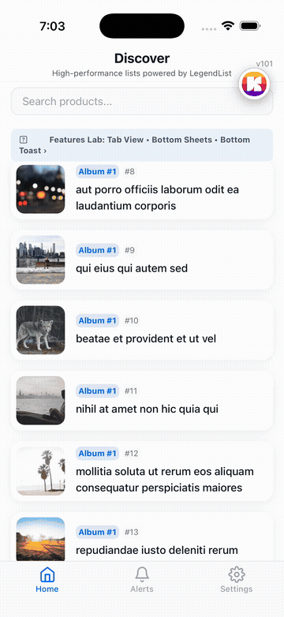

# 🚀 React Native Production Boilerplate (RN 0.88+)

<p align="center">
  
</p>

<p align="center">
  <b>A clean, production-ready React Native boilerplate built on React Native 0.88 & React 19 with the New Architecture enabled. Designed for speed, type safety, and beginner-friendly maintainability.</b>
</p>

<p align="center">
  <a href="https://reactnative.dev"></a>
  <a href="https://react.dev"></a>
  <a href="https://www.typescriptlang.org/"></a>
  <a href="https://reactnative.dev/docs/the-new-architecture/landing-page"></a>
  <a href="https://jestjs.io/"></a>
  <a href="LICENSE"></a>
</p>

---

## 📱 Demo & Preview

<p align="center">
  
  <br /><br />
  <sub>📱 <b>Full App Walkthrough Demo</b></sub><br />
  <sub>High-speed list rendering • Unistyles runtime dark theme & status bar sync • Features & UI Lab with Swmansion Bottom Sheets (Stacked & Keyboard-handled with smart backdrop dismiss) • Native HUD bottom toasts & Global API cancellation.</sub>
  <br /><br />
  <sub>
    <a href="./docs/assets/demo.mov">▶️ <b>Watch Demo Video (demo.mov)</b></a>
  </sub>
</p>

---

## 📖 In-Depth Technical Guide

Looking for native module implementation tutorials (TurboModules & Fabric), Android/iOS build internals, or deep architectural breakdowns?

👉 **[Read the Full Documentation Guide (docs/DOCUMENTATION.md)](./docs/DOCUMENTATION.md)**

---

## 🌟 What's Inside

| Feature | Technology | Description |
| :--- | :--- | :--- |
| **New Architecture** | Fabric & TurboModules | 100% C++ JSI / Hermes V1 enabled with custom native modules |
| **Styling** | [Unistyles v3](https://github.com/jpudysz/react-native-unistyles) | High-performance C++ theming with automatic light/dark mode and zero re-renders |
| **Multi-Environment** | [react-native-keys](https://github.com/numandev1/react-native-keys) | Secure JSI encrypted keys for Dev, Staging, and Production |
| **Bottom Sheets** | [@swmansion/react-native-bottom-sheet](https://github.com/software-mansion/react-native-bottom-sheet) | Official Software Mansion modal sheets with multi-level stacking & keyboard avoidance |
| **Tab View** | [react-native-tab-view](https://github.com/satya164/react-native-tab-view) | High performance swipable tabs backed by `react-native-pager-view` |
| **Native Bottom Toast** | [react-native-toast-message](https://github.com/calintamas/react-native-toast-message) | Capsule HUD toast anchored above soft nav bars with auto API error display |
| **Android Soft Navigation** | Safe Area Insets Calculation | Automated safe clearance above on-screen 3-button & gesture navigation bars |
| **State Management** | Redux Toolkit & Zustand | Redux Toolkit for complex domain data + Zustand for lightweight UI & auth |
| **Storage** | [react-native-mmkv](https://github.com/mrousavy/react-native-mmkv) | High-speed encrypted storage (30x faster than AsyncStorage) |
| **Navigation** | React Navigation v7 | Type-safe Native Stack and Bottom Tabs with deep linking support |
| **Global Loader** | [react-native-root-siblings](https://github.com/magicismight/react-native-root-siblings) | Fullscreen overlay controllable from anywhere without native modal conflicts |
| **API Cancellation** | Axios + AbortController | Automatic request cancellation on unmount and bulk cancellation on logout |
| **Network Resilience** | `normalizeApiError` | Standardized error normalization for offline drops, timeouts, HTTP codes, and cancels |
| **Internationalization** | i18next | Multi-language support (English, Arabic, Spanish) with auto RTL restart |
| **Testing** | Jest & RNTL | 21 test suites (85 tests) covering bottom sheets, tabs, toasts, state, and UI |

---

## 📋 Prerequisites

Before starting, make sure your environment has:

1. **Node.js**: `>= 18` (LTS recommended)
2. **Yarn**: `v1` (Classic) or Modern
3. **Android**: Android Studio with SDK Platform 36/37 and JDK 17
4. **iOS** *(macOS only)*: Xcode `>= 15.0` and CocoaPods (`brew install cocoapods`)

👉 See the [Official React Native Environment Setup Guide](https://reactnative.dev/docs/set-up-your-environment) if you are setting up a machine for the first time.

---

## ⚡ Quick Start

### 1. Clone & Install

```bash
# Clone the repository
git clone https://github.com/<your-username>/<your-repo-name>.git
cd RN_BoilerplateLatest

# Install dependencies and iOS CocoaPods in one command
yarn install:all
```

> [!TIP]
> Need to reset caches or reinstall cleanly? Run `yarn clean:install`.

---

### 2. Run the App

Start Metro bundler in one terminal:
```bash
yarn start
```

Run on your target platform:

| Environment | Android Command | iOS Command |
| :--- | :--- | :--- |
| **Development** (default) | `yarn android` | `yarn ios` |
| **Staging** | `yarn android:staging` | `yarn ios:staging` |
| **Production** | `yarn android:prod` | `yarn ios:prod` |

---

### 3. Build Release Binaries

```bash
# Android Production APK
yarn build:android

# Android Production AAB (for Google Play)
yarn bundle:android

# iOS Production Release App
yarn build:ios
```

---

## 💡 Beginner How-To Guides

### 1. How to Use Environment Variables (`react-native-keys`)

Environment variables and secret keys live in JSON files at the project root.
These files are **git-ignored** (they contain secrets). Create them from the template:

```bash
cp keys.example.json keys.development.json
cp keys.example.json keys.staging.json
cp keys.example.json keys.production.json
cp keys.example.json keys.json
```

Then edit `APP_ENV`, `APP_NAME`, `BUNDLE_ID`, `API_BASE_URL` and replace the
`SECRET_KEY` / `MMKV_ENCRYPTION_KEY` placeholders (the MMKV key must be 16 characters or fewer; e.g. `openssl rand -hex 8`).
In CI, write these files from your secret store before building. Never commit them.

- `keys.development.json`
- `keys.staging.json`
- `keys.production.json`

To read variables in your TypeScript code, use `@config`:

```typescript
import { Config } from '@config';

// 1. Read public variables (API endpoints, environment name, etc.)
const apiUrl = Config.publicFor('API_BASE_URL');
const appEnv = Config.publicFor('APP_ENV'); // 'development' | 'staging' | 'production'

// 2. Read encrypted / secure secrets (JSI memory-protected)
const secretKey = Config.secureFor('SECRET_KEY');
```

---

### 2. How to Show & Hide the Global Loader

The loader is powered by `react-native-root-siblings`. It renders above all screens and navigation without native `<Modal>` bugs:

```typescript
import { AppConstant } from '@services/AppConstant';

// Show loader with an optional message
AppConstant.showLoader('Please wait...');

// Hide loader when done
AppConstant.hideLoader();
```

> [!NOTE]
> You can also import `GlobalLoader` from `@components/organisms` and call `GlobalLoader.show('...')` / `GlobalLoader.hide()` directly.

---

### 3. How to Cancel API Calls on Unmount

Prevent memory leaks and unwanted state updates when a user leaves a screen before an API call finishes:

```typescript
import React, { useEffect } from 'react';
import { useApiCancellation } from '@hooks';
import { apiClient } from '@api';

export const MyScreen = () => {
  // 1. Get an AbortSignal automatically cancelled on component unmount
  const { signal } = useApiCancellation();

  useEffect(() => {
    // 2. Pass the signal to your API request
    apiClient.get('/photos', { signal })
      .then(res => console.log(res.data))
      .catch(err => {
        // Cancelled requests are automatically ignored by client interceptors!
      });
  }, [signal]);

  return <View>...</View>;
};
```

To cancel **all** pending API requests across the entire app at once (e.g. on logout):
```typescript
import { AppConstant } from '@services/AppConstant';

AppConstant.cancelAllRequests();
```

---

### 4. How to Handle Network & API Errors

Use `normalizeApiError` to translate raw Axios exceptions, offline network drops, and timeouts into user-friendly messages:

```typescript
import { normalizeApiError } from '@api';
import { Toast } from '@components/organisms';

try {
  const data = await homeApi.getPhotos({ page: 1 });
} catch (error) {
  const { message, isNetworkError, isTimeout, isCanceled } = normalizeApiError(error);

  if (isCanceled) return; // Ignore unmount aborts

  if (isNetworkError) {
    // Shows native HUD capsule toast at the bottom:
    Toast.error(message, 'Network Error');
  }
}
```

> [!TIP]
> **Zero-Boilerplate Global Network Handling**: You do not even need to write manual try/catch blocks for basic network failures! The Axios response interceptor (`src/api/client.ts`) automatically surfaces a bottom `Toast.error` whenever an offline drop (`ERR_NETWORK`) or 5xx server error occurs, unless `{ silent: true }` is passed in request config.

---

### 5. How to Display Native Bottom Toasts

We use `react-native-toast-message` customized into a native HUD capsule anchored at the **bottom** (`position: 'bottom'`). It automatically offsets itself above the Android soft navigation bar and iOS home indicator:

```typescript
import { Toast } from '@components/organisms';
// Or via AppConstant:
import { AppConstant } from '@services/AppConstant';

// 1. Error toast (Red accent with Alert icon)
Toast.error('Unable to connect to the server. Please check your internet connection.');

// 2. Success toast (Green accent with Check icon)
Toast.success('Profile preferences updated successfully.');

// 3. Warning toast (Amber accent with Warning icon)
Toast.warning('Session expiring in 2 minutes.');

// 4. Info toast (Blue accent with Info icon)
Toast.info('A newer version of the catalog is available.');

// 5. Dismiss any active toast
Toast.hide();
```

---

### 6. How to Use Stacked & Keyboard Bottom Sheets (`@swmansion/react-native-bottom-sheet`)

We utilize `@swmansion/react-native-bottom-sheet` (Software Mansion's official bottom sheet) hosted within `<BottomSheetProvider>`.

#### A. Stacked Bottom Sheets (Layered Modals)
Allows presenting a second modal sheet on top of the first, with fluid backdrop scrim layering and independent detents:

```typescript
import React, { useRef } from 'react';
import { Button } from '@components/atoms';
import { StackedBottomSheet, StackedBottomSheetRef } from '@components/organisms';

export const MyScreen = () => {
  const sheetRef = useRef<StackedBottomSheetRef>(null);

  return (
    <>
      <Button title="Open Stacked Sheet" onPress={() => sheetRef.current?.present()} />
      <StackedBottomSheet ref={sheetRef} />
    </>
  );
};
```

#### B. Keyboard-Handled Bottom Sheet
Implements seamless keyboard tracking using `ModalBottomSheet` with `detents={[0, 'content']}` and `KeyboardAwareScrollView` from `react-native-keyboard-controller` (per Swmansion official examples):
- **Smart Backdrop Press**: Tapping the backdrop while the keyboard is visible hides the keyboard (`Keyboard.dismiss()`) via `useKeyboardState`. Tapping when the keyboard is hidden closes the bottom sheet.

```typescript
import React, { useRef } from 'react';
import { Button } from '@components/atoms';
import { KeyboardBottomSheet, KeyboardBottomSheetRef } from '@components/organisms';

export const FeedbackScreen = () => {
  const keyboardSheetRef = useRef<KeyboardBottomSheetRef>(null);

  return (
    <>
      <Button title="Open Feedback Sheet" onPress={() => keyboardSheetRef.current?.present()} />
      <KeyboardBottomSheet ref={keyboardSheetRef} />
    </>
  );
};
```

---

### 7. How Android On-Screen Soft Navigation Bars Are Handled

Many Android devices utilize an on-screen soft navigation bar (3-button layout ~48dp or 2-button / gesture bar ~16-24dp). If an app only accounts for `insets.bottom` on devices with translucent navigation bars or edge-to-edge layouts, bottom-fixed UI elements (bottom sheets, toasts, floating action buttons) can be partially obscured by the buttons.

Our components use a standard safe clearance formula:

```typescript
import { Platform } from 'react-native';
import { useSafeAreaInsets } from 'react-native-safe-area-context';

const insets = useSafeAreaInsets();

// Safe bottom clearance guaranteeing zero soft navigation overlap:
const bottomInset = Math.max(insets.bottom, Platform.OS === 'android' ? 16 : 10) + 12;
```

- **Bottom Sheets**: `bottomInset={bottomInset}` applied to `<ModalBottomSheet>` content and `KeyboardAwareScrollView`.
- **Toasts**: `bottomOffset: Math.max(insets.bottom, Platform.OS === 'android' ? 16 : 10) + 16`.
- **Tab Content**: `paddingBottom: insets.bottom + 24`.

---

### 8. Interactive Features Lab (`TabViewDemoScreen`)

A verification screen powered by `react-native-tab-view` and `react-native-pager-view` is included out of the box to test all components interactively:
- **Tab 1: Bottom Sheets**: Test Level 1 & Level 2 Stacked Sheets and Keyboard-Handled Sheets live.
- **Tab 2: Toast & Network**: Simulate offline drops, 500 server errors, custom success/warning HUD capsules, and bulk request cancellation.
- **Tab 3: Architecture**: Real-time stack verification matrix.

You can navigate to it from **HomeScreen** (via the *"Features Lab"* button) or from **SettingsScreen** (via the *"Features & UI Lab"* list item).

---

### 9. How to Style with Unistyles & Themes

Styles are written with `StyleSheet.create` from `react-native-unistyles`. They adapt automatically to light/dark mode and orientation:

```typescript
import React from 'react';
import { View } from 'react-native';
import { StyleSheet } from 'react-native-unistyles';
import { Text } from '@components/atoms';

export const UserCard = () => (
  <View style={styles.card}>
    <Text variant="heading" weight="bold">Welcome</Text>
  </View>
);

const styles = StyleSheet.create(theme => ({
  card: {
    backgroundColor: theme.colors.surface,
    padding: theme.spacing.md,
    borderRadius: 12,
    borderWidth: 1,
    borderColor: theme.colors.border,
  },
}));
```

---

### 10. How to Use State Management

- **Zustand** (for lightweight UI, auth, and theme state):
  ```typescript
  import { useAuthStore } from '@store';

  const user = useAuthStore(state => state.user);
  const login = useAuthStore(state => state.login);
  ```

- **Redux Toolkit** (for complex domain state, async thunks, and caching):
  ```typescript
  import { useAppDispatch, useAppSelector } from '@store';
  import { fetchPhotos } from '@features/home/store/homeSlice';

  const dispatch = useAppDispatch();
  const { photos, isLoading } = useAppSelector(state => state.home);

  useEffect(() => {
    const promise = dispatch(fetchPhotos());
    return () => {
      promise.abort(); // Auto abort thunk on unmount
    };
  }, [dispatch]);
  ```

---

## 📂 Project Structure

```text
RN_BoilerplateLatest/
├── android/               # 🤖 Native Android configuration & ProGuard rules
├── ios/                   # 🍏 Native iOS configuration, Podfile & Xcode schemes
├── keys.*.json            # 🔑 Per-env keys & secrets (git-ignored; copy keys.example.json)
├── src/
│   ├── api/               # 🌐 Axios client, endpoints, and error normalizer
│   ├── assets/            # 🎨 Vector icons (SVGs) and images
│   ├── components/        # 🧱 Reusable UI components (Atomic Design)
│   │   ├── atoms/         #    Basic building blocks: Button, Text, Input, Spacer
│   │   ├── molecules/     #    Combinations: Card, ListItem
│   │   └── organisms/     #    Header, GlobalLoader, Toast, StackedBottomSheet, KeyboardBottomSheet
│   ├── config/            # ⚙️ Constants, environment wrapper (Config)
│   ├── features/          # 📦 Feature-driven modules
│   │   ├── auth/          #    Login & authentication
│   │   ├── home/          #    Product/Photo lists, TabViewDemoScreen
│   │   ├── notifications/ #    Notifee notification triggers
│   │   └── settings/      #    Theme, language & UI lab links
│   ├── hooks/             # 🪝 Custom hooks (useApiCancellation, useDebounce)
│   ├── locales/           # 🌍 Translation files (en, ar, es)
│   ├── navigation/        # 🧭 Navigation stacks, bottom tabs, and TabViewDemo route
│   ├── services/          # 🔌 Storage (MMKV), i18n setup
│   ├── store/             # 🧠 Redux Toolkit slices and Zustand stores
│   ├── theme/             # 🎨 Color tokens, typography, and spacing
│   └── types/             # 📘 Global TypeScript interfaces & ambient declarations
├── __tests__/             # 🃏 Jest unit and integration test suites (33 suites, 128 tests)
├── CONTRIBUTING.md        # 🤝 Workflow, commit and quality rules
├── keys.example.json      # 🔑 Template for the git-ignored keys.*.json files
└── package.json
```

---

## 🛠️ Handy Scripts Reference

| Command | What It Does |
| :--- | :--- |
| `yarn start` | Starts Metro bundler with cache reset |
| `yarn android` | Runs Android in Development flavor |
| `yarn android:staging` | Runs Android in Staging flavor |
| `yarn android:prod` | Runs Android in Production flavor |
| `yarn ios` | Runs iOS with Dev scheme |
| `yarn ios:staging` | Runs iOS with Staging scheme |
| `yarn ios:prod` | Runs iOS with Production scheme |
| `yarn test` | Runs all Jest test suites |
| `yarn test:coverage` | Runs tests with coverage thresholds enforced |
| `yarn typecheck` | Checks TypeScript for errors (`tsc --noEmit`) |
| `yarn lint` | Checks ESLint rules |
| `yarn lint:fix` | Fixes ESLint and auto-removes unused imports |
| `yarn format` | Formats the codebase with Prettier |
| `yarn format:check` | Verifies `src`, `__tests__` and `specs` formatting |
| `yarn knip:check` | Finds unused files, exports and dependencies |
| `yarn clean:install` | Deep cleans caches and performs a fresh install |

---

## 🛡️ Code Quality & Quality Assurance

- **Strict TypeScript**: `noImplicitAny: true` and `strictNullChecks: true`. Zero `any` policy.
- **ESLint Protection**: Strict React Hooks rules (`rules-of-hooks`, `exhaustive-deps`), no inline style allocations, and automatic unreferenced import pruning on save.
- **Passing Tests with Coverage Gates**: 33 suites / 128 tests cover components, hooks, auth flows, API client (401 refresh), storage, config and state. Jest enforces global coverage thresholds (`coverageThreshold` in `jest.config.js`).
- **CI & Git Hooks**: GitHub Actions (`.github/workflows/ci.yml`) runs typecheck, lint, format check, tests and knip. Husky runs lint-staged on commit and commitlint (Conventional Commits) on the message.
- **Secrets Hygiene**: `keys.*.json` are git-ignored; only `keys.example.json` is committed. Android release signing reads `RELEASE_*` Gradle properties or env vars.
- **Crash Reporting Hook**: `@services/crashReporting` is a vendor-neutral facade (`setCrashReporter`) wired to the root `ErrorBoundary`.
- **Release Optimization**: Console statements and debuggers are stripped automatically in production builds via Terser.

---

## 📄 License

This project is licensed under the [MIT License](LICENSE).
