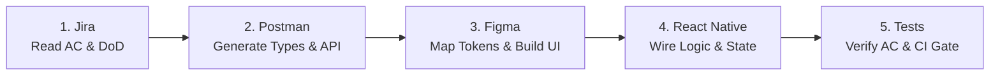
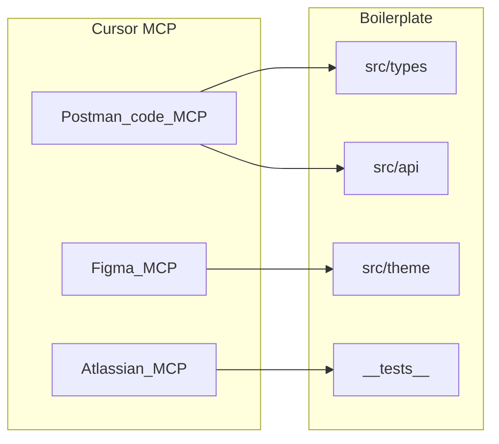

# Spec-Driven Development (SDD) Guide
### Integrating Jira, Figma, and Postman into React Native

---

## 1. What is Spec-Driven Development?

**Spec-Driven Development (SDD)** is an engineering workflow where code is written only after three specifications are agreed upon and locked:

1. **Product Spec (Jira)**: Defines business requirements, user flows, and acceptance criteria.
2. **Design Spec (Figma)**: Defines design tokens, responsive layouts, and interactive UI states.
3. **API Contract (Postman)**: Defines request/response payloads, endpoints, and error schemas.

Instead of guessing requirements, hardcoding styles, or waiting for backend APIs to go live, specifications drive TypeScript types, components, and tests directly.

```
Jira (Behavior)   +   Figma (UI Tokens)   +   Postman (Data Contract)
       │                      │                         │
       ▼                      ▼                         ▼
  Unit Tests          Unistyles Stylesheet         TypeScript Types & API
(Acceptance Criteria)    (Design System)               (Axios Client)
       │                      │                         │
       └──────────────────────┼─────────────────────────┘
                              ▼
                  Production Implementation
```

---

## 2. Integration Mapping

How each specification artifact maps directly into this boilerplate:

| Spec Source | Spec Artifact | Boilerplate Target | Implementation Output |
| :--- | :--- | :--- | :--- |
| **Jira** | User Story & Acceptance Criteria | `__tests__/**/*.test.tsx` | Jest + RNTL unit test cases for each scenario |
| **Jira** | Definition of Done (DoD) | `scripts/ci.sh` | Quality gates (`typecheck`, `lint`, `test`) |
| **Figma** | Design Tokens (Colors, Spacing) | `src/theme/tokens.ts`, `src/theme/themes.ts` | Type-safe Unistyles tokens (`theme.colors.*`) |
| **Figma** | Component States & Variants | `src/components/atoms/`, `src/components/molecules/` | Atomic components matching design states |
| **Postman** | Request / Response JSON Schemas | `src/types/*.ts` | Strictly-typed TypeScript interfaces |
| **Postman** | Endpoints & Error Codes | `src/api/client.ts`, `src/api/*.ts` | Typed Axios calls with unified error handling |
| **Postman** | Mock Server | `keys.development.json` (`API_URL`) | Zero-backend frontend development |

---

## 3. Workflow: From Integration to Implementation



### Step 1: Ingest Product Spec (Jira)
- Read the ticket **Acceptance Criteria (AC)** (Given-When-Then format).
- Identify positive paths, validation errors, and edge cases.
- Use the AC scenarios as the exact test cases for your unit test suite.

### Step 2: Ingest API Spec (Postman)
- Review endpoints, HTTP methods, and JSON request/response schemas.
- If the backend is not yet deployed, use the **Postman Mock Server** URL.
- Translate the response schemas into TypeScript interfaces in `src/types/`.
- Create typed API caller functions in `src/api/`.

### Step 3: Ingest Design Spec (Figma)
- Open Figma Dev Mode.
- Inspect design tokens: spacing (`theme.spacing.*`), colors (`theme.colors.*`), border radius (`theme.radius.*`).
- Inspect component states: `idle`, `focused`, `disabled`, `error`, `loading`.
- Build UI by reusing atomic components in `src/components/` without hardcoding pixel values or hex colors.

### Step 4: Implement in React Native
- Assemble the UI using atomic components and Unistyles v3.
- Wire API calls through the service layer with standardized error handling (`normalizeApiError`).
- Handle device-level concerns (soft keyboard, safe areas, edge-to-edge, dynamic theme).

### Step 5: Test & Validate (Definition of Done)
- Write unit tests named directly after the Jira Acceptance Criteria.
- Run local quality checks before opening a Pull Request:
  ```bash
  npm run typecheck   # 0 TypeScript errors
  npm run lint        # 0 ESLint warnings/errors
  npm test            # All AC tests pass
  ```

### 3.1 MCP in Cursor (Jira, Postman, Figma)

**Model Context Protocol (MCP)** lets Cursor Agent read live specs from Jira, Postman, and Figma instead of copying tickets, collections, and frames by hand. The flow below matches §1–§3; repository targets stay the same as §2.



#### Setup

| Tool | Install in Cursor | Auth | SDD use |
| :--- | :--- | :--- | :--- |
| **Jira** | [Atlassian MCP](https://support.atlassian.com/atlassian-ai-gateway/docs/get-started-with-the-atlassian-remote-mcp-server/) (Marketplace plugin or URL below) | OAuth — **Settings → Tools & MCP → Connect** | Ticket, AC, comments |
| **Postman** | [Postman remote MCP](https://learning.postman.com/docs/reference/postman-api/postman-mcp-server/postman-mcp-remote-server/) — use **`/code`** | OAuth (US) or API key in **user** config only | Schemas, mock URL, endpoints |
| **Figma** | `/add-plugin figma` or [remote MCP](https://developers.figma.com/docs/figma-mcp-server/remote-server-installation/) | OAuth **Connect** | Variables/tokens, frames, states |

Store config in `~/.cursor/mcp.json` (global) or `.cursor/mcp.json` (project). **Do not commit API keys.** Prefer OAuth for Atlassian, Figma, and US Postman.

Reference `mcpServers` block (OAuth-friendly; no secrets):

```json
{
  "mcpServers": {
    "atlassian": {
      "url": "https://mcp.atlassian.com/v2/mcp"
    },
    "postman": {
      "url": "https://mcp.postman.com/code"
    },
    "figma": {
      "url": "https://mcp.figma.com/mcp"
    }
  }
}
```

- **EU Postman:** `https://mcp.eu.postman.com/code` and `Authorization: Bearer <POSTMAN_API_KEY>` in headers — see [Postman remote MCP](https://learning.postman.com/docs/reference/postman-api/postman-mcp-server/postman-mcp-remote-server/).
- **Teams / Enterprise only:** assigning Jira work to `@Cursor` is a [separate Cursor–Jira integration](https://cursor.com/docs/integrations/jira), not required for local SDD with Atlassian MCP.

#### Agent loop (maps to §3)

| Step | Agent prompt (pattern) | Output paths |
| :--- | :--- | :--- |
| 1 Jira | Fetch `PROJ-123`, list AC, draft Jest cases 1:1 | `__tests__/**/*.test.tsx` |
| 2 Postman | From collection `<name>`, generate TS types + `apiClient` wrappers; mock base URL in dev keys | `src/types/`, `src/api/`, `keys.development.json` (`API_URL`) |
| 3 Figma | Map Figma variables to `theme.spacing` / `theme.colors`; list atom states | `src/theme/tokens.ts`, `src/components/atoms/` |
| 4 RN | Implement per `.cursor/rules/react-native.mdc`, i18n, Unistyles; `normalizeApiError` for API errors | `src/features/<feature>/` |
| 5 DoD | Verify AC tests, tokens, contract; run `yarn typecheck`, `yarn lint`, `yarn test` | §5 checklist |

**Starter agent message** (copy and fill in):

```text
SDD implement this ticket:
- Jira: PROJ-123
- Figma: <file or frame link>
- Postman collection: <workspace/collection name>

Order: (1) fetch Jira AC, (2) types + api from Postman, (3) map Figma tokens, (4) feature code, (5) tests named per AC. Follow repo rules and paths in docs/SPEC_DRIVEN_DEVELOPMENT.md.
```

#### §4 example with MCP

- Agent pulls the feedback story AC from Jira, the `/feedback` contract from Postman, and sheet/input tokens from Figma before editing code.
- Same targets as §4: `src/types/feedback.ts`, `src/api/feedbackApi.ts`, component under `src/components/`, tests in `__tests__/`.

---

## 4. Practical Example: Feedback Bottom Sheet

### 1. Jira Ticket (Spec)
> **Story:** User submits feedback from bottom sheet.  
> **AC 1:** Topic is mandatory; if empty on submit, show error toast `"Please enter a feedback title"`.  
> **AC 2:** Tapping backdrop when keyboard is visible dismisses the keyboard and keeps sheet open.  
> **AC 3:** On success, display success toast `"Saved: <topic>"` and close the sheet.

### 2. Postman Contract & TypeScript (`src/types/feedback.ts`)
```typescript
export interface FeedbackRequest {
  topic: string;
  description?: string;
  platform: 'ios' | 'android';
}

export interface FeedbackResponse {
  id: string;
  topic: string;
  status: 'received';
  createdAt: string;
}
```

### 3. API Service (`src/api/feedbackApi.ts`)
```typescript
import { apiClient } from './client';
import { FeedbackRequest, FeedbackResponse } from '../types/feedback';

export const feedbackApi = {
  submitFeedback: async (payload: FeedbackRequest): Promise<FeedbackResponse> => {
    const { data } = await apiClient.post<FeedbackResponse>('/feedback', payload);
    return data;
  },
};
```

### 4. Component Implementation (`src/components/organisms/FeedbackSheet.tsx`)
```typescript
import React, { useState, forwardRef, useCallback } from 'react';
import { View, TextInput, Keyboard } from 'react-native';
import { ModalBottomSheet } from '@swmansion/react-native-bottom-sheet';
import { useKeyboardState } from 'react-native-keyboard-controller';
import { StyleSheet, useUnistyles } from 'react-native-unistyles';
import { Button, Spacer, Text } from '@components/atoms';
import { Toast } from './Toast';

export const FeedbackSheet = forwardRef((_, ref) => {
  const { theme } = useUnistyles();
  const [index, setIndex] = useState(0);
  const [title, setTitle] = useState('');

  // Spec: Dismiss keyboard on backdrop press if visible
  const isKeyboardVisible = useKeyboardState(state => state.isVisible);

  const handleCloseRequest = useCallback(() => {
    if (isKeyboardVisible) {
      Keyboard.dismiss();
    } else {
      setIndex(0);
    }
  }, [isKeyboardVisible]);

  const handleSubmit = useCallback(() => {
    // AC 1: Topic validation
    if (!title.trim()) {
      Toast.error('Please enter a feedback title', 'Validation Error');
      return;
    }
    // AC 3: Success feedback
    Toast.success(`Saved: ${title.trim()}`, 'Submission Received');
    setTitle('');
    setIndex(0);
  }, [title]);

  return (
    <ModalBottomSheet index={index} onIndexChange={setIndex} onCloseRequest={handleCloseRequest}>
      <View style={styles.container}>
        <Text variant="title">Feedback Topic</Text>
        <TextInput
          value={title}
          onChangeText={setTitle}
          placeholder="Topic"
          placeholderTextColor={theme.colors.textSecondary}
          style={styles.input}
          testID="input-topic"
        />
        <Spacer size="md" />
        <Button title="Submit Feedback" onPress={handleSubmit} testID="btn-submit" />
      </View>
    </ModalBottomSheet>
  );
});

const styles = StyleSheet.create(theme => ({
  container: {
    padding: theme.spacing.lg,
    backgroundColor: theme.colors.surface,
  },
  input: {
    borderWidth: 1,
    borderColor: theme.colors.border,
    borderRadius: theme.radius.md,
    padding: theme.spacing.md,
    color: theme.colors.text,
  },
}));
```

### 5. Unit Tests Mapped to AC (`__tests__/components/FeedbackSheet.test.tsx`)
```typescript
import React from 'react';
import { Keyboard } from 'react-native';
import { useKeyboardState } from 'react-native-keyboard-controller';
import { render, screen, fireEvent, act } from '@test-utils';
import { FeedbackSheet } from '@components/organisms';
import { Toast } from '@components/organisms/Toast';

jest.spyOn(Toast, 'error');
jest.spyOn(Toast, 'success');

describe('Jira AC Verification: FeedbackSheet', () => {
  it('AC 1: displays error toast when topic is empty', async () => {
    await render(<FeedbackSheet />);
    fireEvent.press(screen.getByTestId('btn-submit'));
    expect(Toast.error).toHaveBeenCalledWith('Please enter a feedback title', 'Validation Error');
  });

  it('AC 2: dismisses keyboard on backdrop tap when keyboard is visible', async () => {
    const dismissSpy = jest.spyOn(Keyboard, 'dismiss');
    (useKeyboardState as jest.Mock).mockReturnValue(true);

    await render(<FeedbackSheet />);
    await act(async () => {
      screen.getByTestId('mock-modal-bottom-sheet').props.onCloseRequest();
    });

    expect(dismissSpy).toHaveBeenCalledTimes(1);
    expect(screen.getByTestId('mock-modal-bottom-sheet').props.index).not.toBe(0);
  });
});
```

---

## 5. Definition of Done (DoD) Checklist

Before submitting a Pull Request:

- [ ] **Jira**: All Acceptance Criteria implemented and mapped 1:1 to unit tests.
- [ ] **Figma**: UI matches design tokens (`theme.colors.*`, `theme.spacing.*`) with zero hardcoded values; light/dark themes verified.
- [ ] **Postman**: TypeScript interfaces match API contract; error payloads handled via `normalizeApiError`.
- [ ] **MCP**: Implementation matches specs fetched from Jira (AC), Postman (schemas/endpoints), and Figma (tokens/states)—no undocumented drift from manual paste.
- [ ] **Quality Gates**:
  - `npm run typecheck` passes (0 errors).
  - `npm run lint` passes (0 warnings/errors).
  - `npm test` passes (all unit test suites green).
